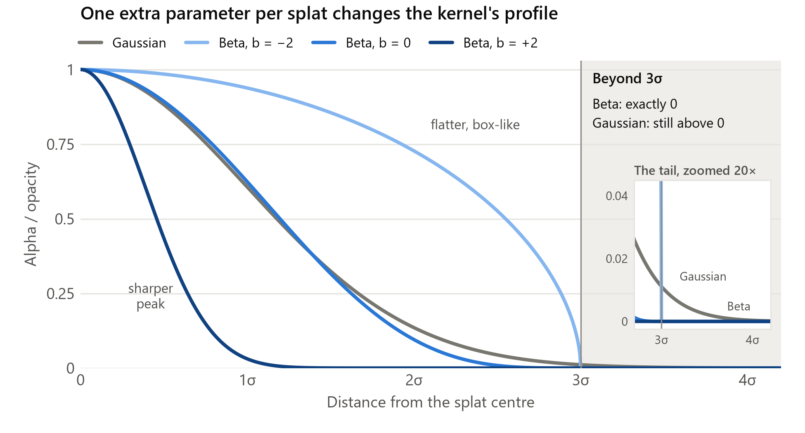
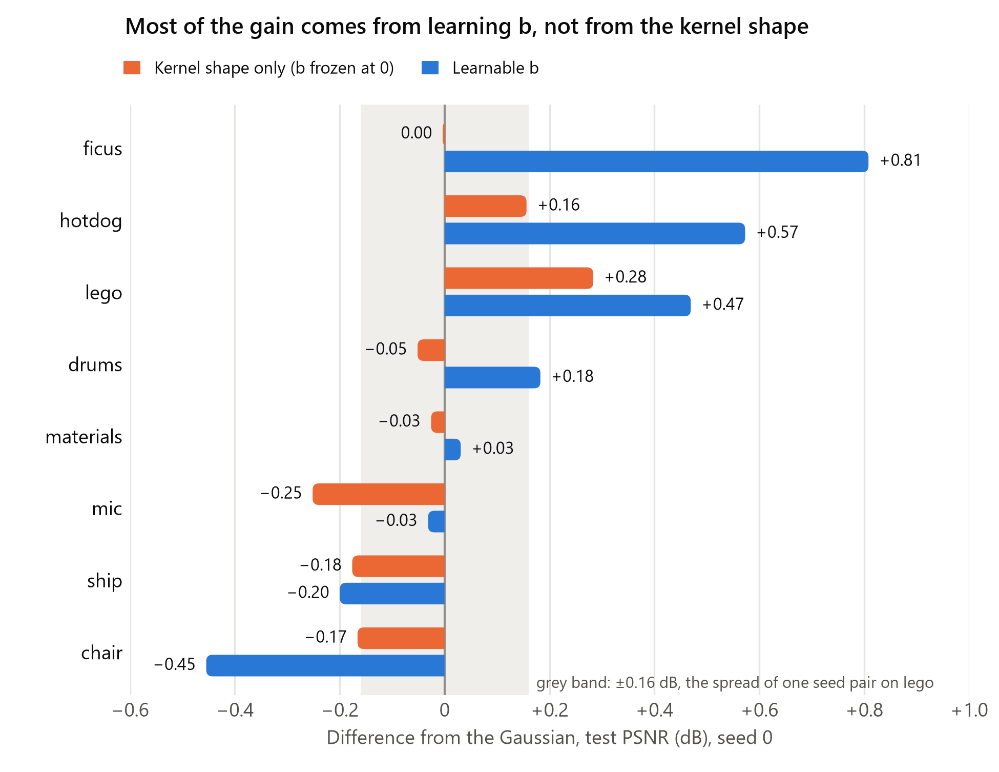
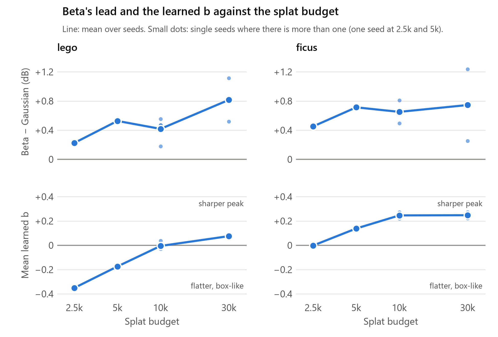
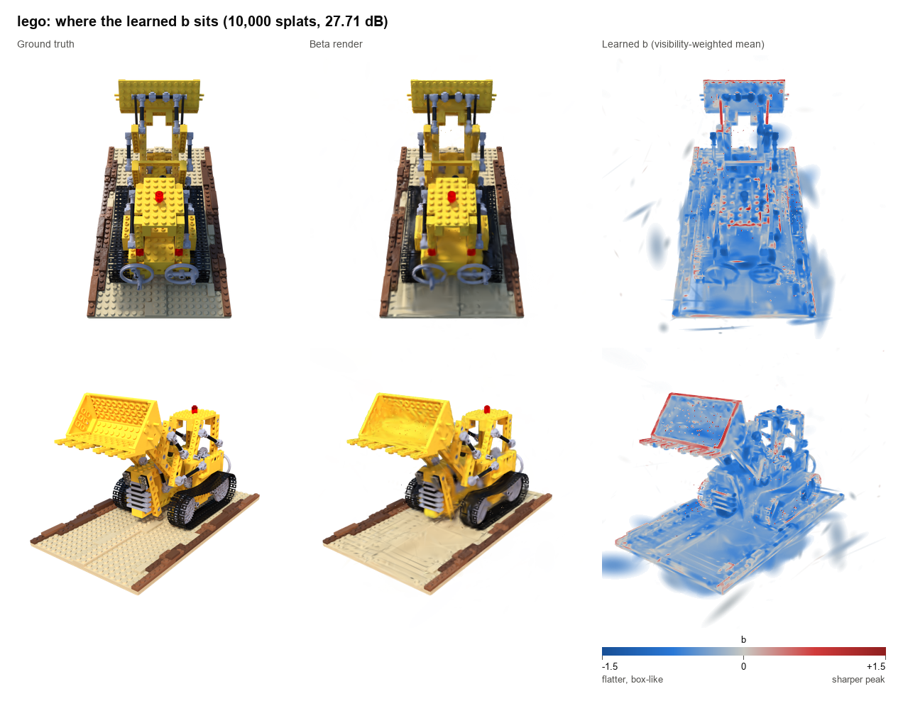
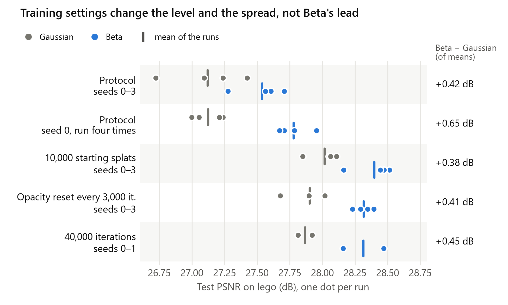
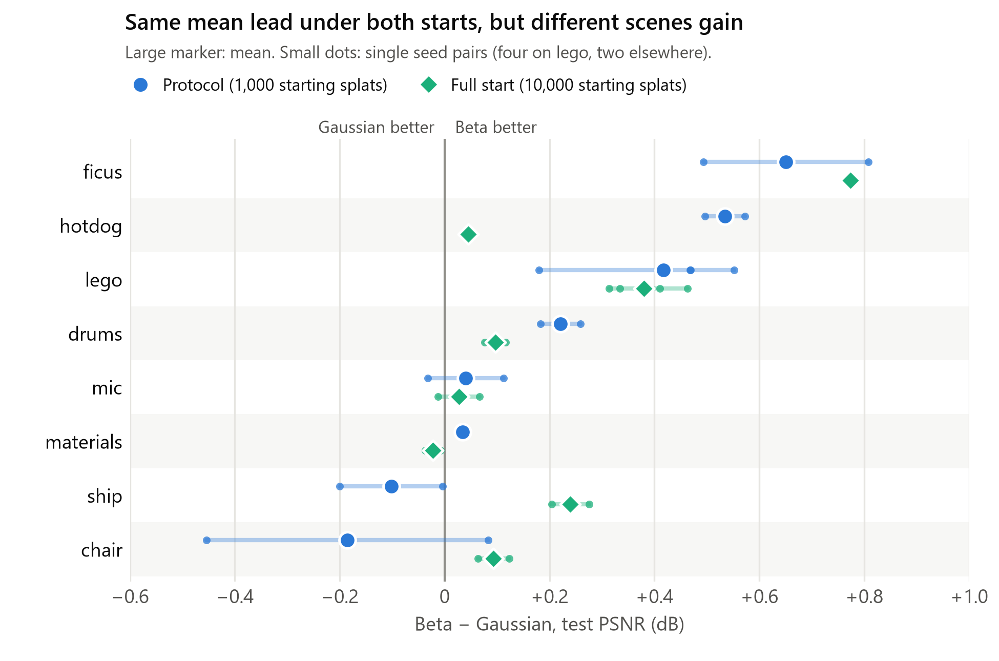

# Does a Beta kernel beat the Gaussian in a small-budget 3DGS trainer?

George Yeo · CP4282 individual project · 13 November 2026

## Summary

I replaced the Gaussian kernel in the course Warp 3DGS trainer with the Beta kernel from
Deformable Beta Splatting. With the Beta kernel, every splat learns 1 extra shape parameter b.
I compared the 2 kernels under a fixed protocol on the 8 NeRF-synthetic scenes (10,000 splats,
400 px, 20,000 iterations).

- Beta is ahead by **+0.22 dB PSNR on average** over 18 seed-paired runs. LPIPS is lower in 15
  of 18. The cost is about 3% more time per iteration and 1 extra float per splat.
- The gain comes from **letting each splat learn b**. With b frozen, the Beta kernel is about
  equal to the Gaussian (−0.03 dB).
- The gain shows up **at object boundaries**. Splats on thin structures and edges learn a
  sharper peak. Large splats on smooth surfaces learn a flatter, box-like profile.
- The gain is **not uniform across scenes**. Ficus (+0.65 dB) and lego (+0.42 dB) lead both
  under the protocol and from a full-capacity start. The other scenes are small, zero, or
  depend on the training setup.
- The protocol itself turned out to be noisy. Starting from 1,000 random splats without opacity
  reset leaves floaters, and these floaters cause most of the seed-to-seed spread. Removing
  them changes the level by up to 0.9 dB but **does not change Beta's lead**.

The kernel-only gain matches what the original paper reports in its own ablation (about
0.2 dB). So the kernel is a real but small improvement. It is not where most of that paper's
headline gain comes from.

## 1. Background and question

3D Gaussian Splatting [1] represents a scene as a set of anisotropic Gaussians and renders them
by alpha blending. A Gaussian has 1 fixed profile: a smooth peak with long tails. So a flat
surface or a hard edge needs many overlapping Gaussians.

Deformable Beta Splatting (DBS) [2] replaces the Gaussian with a bounded Beta kernel. Its
profile is controlled by a learnable parameter per splat. DBS reports a large gain over
3DGS-MCMC [3], but it changes 3 things at once: the kernel, the colour model and the densifier.

This project changes only the kernel. I have 4 questions:

1. Inside the course trainer, with everything else the same, does the Beta kernel beat the
   Gaussian?
2. If it does, does the gain come from the kernel's shape or from learning b?
3. Where does it help (which scenes, which parts of the image), and why?
4. How reliable is the answer, since results move with the random seed?

## 2. Method

### 2.1 The kernel

In the course's notation [6], a splat's alpha at pixel p is α(p) = α₀ · w(p). Here α₀ is the
splat's opacity and w is the kernel weight. Let q = (p − μ)ᵀ Σ⁻¹ (p − μ) be the squared
distance from the splat's projected centre, measured with its projected covariance. The 2
kernels differ only in w:

- Gaussian: w = exp(−q / 2)
- Beta: w = (1 − q / 9)^(4·e^b) for q < 9, and 0 beyond

The 9 is 3σ squared, so the Beta kernel ends exactly at 3σ. b is 1 extra learnable number per
splat. At b = 0 the exponent is 4 and the profile is close to the Gaussian. A positive b gives
a sharper peak. A negative b gives a flatter top with a steeper edge, like a box.

*Figure 1. The Gaussian and the Beta kernel at three values of b, against distance from the
splat centre.*

b is clamped to [−2, 2]. The paper leaves b unbounded, so the clamp is a safeguard I added.
Widening it to [−4, 4] changes PSNR by at most 0.03 dB on lego and hotdog (1 seed), so it does
not affect the results.

### 2.2 Implementation

I implemented the kernel in the forward and backward passes of the course trainer
(`3dgs_trainer.py`), including the analytic gradient for b. The paper gives the kernel but not
its gradients, so I derived them: ∂w/∂q = −(β/9)(1 − q/9)^(β−1) and
∂w/∂b = w · β · ln(1 − q/9), with β = 4·e^b. The main points:

- **b has its own Adam optimiser** and learning rate. After each step it is clamped back into
  its range. When densification creates a child splat, the child inherits its parent's b.
- **Both kernels are cut off at the same alpha.** The course's Compact Box rule cuts a
  Gaussian where its alpha falls to √(α₀·α_min). I use the same threshold for the Beta kernel,
  and the tile assignment uses the same per-splat support as shading. So neither kernel is
  drawn out to 3σ in this trainer. An opaque Gaussian is cut at 2.35σ and an opaque Beta splat
  with b = 0 at 2.12σ. This means the Beta kernel's bounded support does not give it a bigger
  or smaller footprint for free.
- **Starting scales are matched.** A Beta splat at b = 0 is slightly narrower than a Gaussian
  with the same covariance. So I multiply the starting scales by a factor that matches the
  second moment of the truncated footprint at each splat's opacity (1.09 at α₀ = 1). With
  this, a Gaussian model re-rendered as Beta agrees with the original to 44–46 dB, against
  40 dB without scaling.
- **The Gaussian arm is unchanged.** Its gradients are bit-identical before and after I added
  the Beta code.

### 2.3 Correctness checks

I did not count any training run until these passed:

- Finite-difference gradient checks for the Beta kernel, end to end and per pixel out to the
  rim, for b from −2 to 2 (relative error at most 1.2e-2).
- The sparse (sampled) loss path equals the dense path to 1e-7 for both kernels.
- A Beta arm with the kernel-aware densifier is bit-identical to the plain Beta arm at b = 0
  through 3 densification events. This is on CPU, because GPU runs are not bit-reproducible
  (see 4.5).

### 2.4 Arms

| Arm | Kernel | b | Purpose |
|---|---|---|---|
| A | Gaussian | n/a | Baseline |
| B0 | Beta | frozen at 0 | Isolates the kernel shape |
| B | Beta | learnable per splat | The method under test |
| C | Beta | learnable | B plus a densifier that accounts for b when splitting |

A, B0 and B share the same densifier and differ in 1 thing at a time. A → B0 changes the
shape. B0 → B makes b learnable. Arm C is a side check and not part of the comparison. The
course densifier ranks splats by gradient and decides between cloning and splitting by scale,
and both assume a Gaussian. Arm C corrects both for b, to test if the shared densifier holds
Beta back.

## 3. Protocol

I fixed all settings before the main runs.

- **Data:** the 8 NeRF-synthetic scenes [4], 100 training views, 200 test views, 400 × 400.
- **Training:** 20,000 iterations, random initialisation with 1,000 splats, the course
  densifier growing to a fixed capacity, opacity reset off.
- **Loss:** MSE over every pixel of the view. The course default samples 48 pixels per tile,
  but the pilot found the dense loss more than 1 dB better for both arms.
- **Capacity: 10,000 splats for every scene.** A pilot on lego's validation split picked the
  smallest capacity whose Gaussian PSNR was within 0.5 dB of the largest one tried.
- **b learning rate: 0.0005,** chosen from 3 values on lego's validation split.
- **Choices on validation, results on test.** I did not use any test number to pick a setting.
- **Seeds:** 2 per scene and 4 on lego. Every Gaussian run has a Beta run with the same seed,
  and I compare within the pair.
- **Metrics:** PSNR and LPIPS [5] on the test split.

Runs that depart from this protocol are labelled as side checks. Hardware: 1 RTX 5070, about
2.5 minutes of training per run.

The absolute numbers are far below published ones (lego is 27 dB here, 36 dB in the papers).
This is because of the small budget, the low resolution and the random start, and it applies
to both arms.

## 4. Results

### 4.1 Beta leads by 0.22 dB on average

| Scene | Seeds | Gaussian (dB) | Beta (dB) | Beta − Gaussian | Per seed | LPIPS change |
|---|---|---|---|---|---|---|
| ficus | 2 | 26.57 | 27.22 | +0.65 | +0.81, +0.49 | −0.0052 |
| hotdog | 2 | 32.88 | 33.42 | +0.53 | +0.57, +0.50 | −0.0056 |
| lego | 4 | 27.12 | 27.54 | +0.42 | +0.47, +0.18, +0.55, +0.47 | −0.0025 |
| drums | 2 | 23.87 | 24.09 | +0.22 | +0.18, +0.26 | −0.0068 |
| mic | 2 | 30.55 | 30.59 | +0.04 | −0.03, +0.11 | −0.0022 |
| materials | 2 | 24.56 | 24.59 | +0.03 | +0.03, +0.04 | −0.0045 |
| ship | 2 | 26.43 | 26.32 | −0.10 | −0.20, −0.00 | +0.0026 |
| chair | 2 | 29.97 | 29.78 | −0.19 | −0.45, +0.08 | +0.0003 |

*Table 1. Test PSNR under the protocol (mean over seeds) and the paired difference.*

- Over the 18 seed pairs the mean difference is +0.22 dB (standard deviation 0.32, standard
  error 0.075). Beta wins 14 pairs on PSNR and 15 on LPIPS.
- Counting each scene once, the mean is +0.20 dB with a standard error of 0.11, and 6 of 8
  scenes are positive. So the lead on these scenes is clear, but 8 scenes is too few to claim
  it for scenes in general.
- By the median test view, Beta is ahead in 17 of 18 pairs. Where it loses on the mean (ship,
  1 chair seed), it wins most views by a little and loses a few badly (section 4.5).
- Cost: 7.1 ms per iteration against 6.9 ms, and 1 extra float per splat.

### 4.2 The gain comes from learning b

*Figure 2. Frozen-b Beta (B0) and learnable-b Beta (B) against the Gaussian, seed 0.*

With b frozen at 0, Beta is −0.03 dB against the Gaussian on average over the 8 scenes
(standard error 0.06). This is inside the noise, and it is ahead of the Gaussian on only 2
scenes. With b learnable, it adds +0.20 dB on average (standard error 0.11) and helps on 6 of
the 8 scenes: +0.81 dB on ficus and +0.42 dB on hotdog. On lego the frozen kernel already
gains +0.28 dB, so the split there is unclear with 1 seed. On chair and ship both variants
lose.

These losses belong to the runs, not to the kernel. I ran a second frozen-b seed on the 3
scenes where it lost. It gives B0 − A of −0.02 dB on mic, +0.05 dB on ship and +0.04 dB on
chair (seed 0: −0.25, −0.18 and −0.17 dB). At seed 0, the views where a Beta arm is more than
0.5 dB behind come in runs of neighbouring test cameras (ship views 88–111, chair views 0–20
and 178–199). The renders show stray splats there: under ship's basin and in front of the
chair's seat. Outside those views the difference is +0.12 dB on ship and +0.02 dB on chair.

The kernel-aware densifier (arm C) changes nothing: 27.75 against 27.71 dB on lego and 27.47
against 27.50 dB on ficus (1 seed each). So the shared densifier does not hold Beta back. DBS
also uses a densifier that ignores the kernel's shape.

### 4.3 More splats do not shrink the lead

*Figure 3. Top: Beta's lead against the splat budget. Bottom: the mean learned b.*

I expected Beta to help most when splats are scarce, because 1 flexible splat could stand in
for several Gaussians. The opposite happened. The lead is smallest at 2,500 splats and larger
at every bigger budget on both scenes. Between 5,000 and 10,000 it does not change by more
than the noise. At 30,000 (a side check) it roughly doubles on lego and stays level on ficus,
but the 2 seeds disagree widely there.

The learned b explains part of this. With few splats, b goes negative on lego, so splats
flatten to cover area. As the budget grows, b rises, so splats can afford to sharpen. The
shape freedom is used more when there are enough splats to specialise.

### 4.4 What b does: flat surfaces and sharp edges

*Figure 4. Lego, two test views: ground truth, Beta render, and a map of the mean b seen at
each pixel (blue = flat, grey = 0, red = sharp).*

- Broad surfaces (the baseplate, body panels) are covered by flat splats. Rims, thin rods and
  stud outlines are drawn by sharp ones. On ficus the leaves and stems are sharp and the pot is
  flat.
- In all 8 scenes b is negatively rank-correlated with splat size (−0.42 to −0.69). Large
  splats flatten and small splats sharpen.

To see where the error falls, I split every test pixel into 4 regions using the ground truth
only: background, a silhouette band within 2 px of the object's outline, high-gradient detail
inside the object, and smooth interior.

- **Silhouette error falls in 7 of 8 scenes** (by 15% on ficus and 17% on lego) and is flat on
  the 8th.
- On ficus, 78% of the Gaussian's error is in the silhouette band (thin leaves against a white
  background), and almost all of Beta's gain is there.
- The learnable b is what does it. Against the frozen kernel, learnable b lowers silhouette
  error on 7 of the 8 scenes (not ship). The frozen kernel against the Gaussian has no
  consistent effect.

So the evidence is consistent with 1 mechanism: a bounded kernel with a learnable profile
draws boundaries with less blur than a Gaussian's tails allow.

### 4.5 Why the seed matters, and how to reduce it

Under the protocol, the Gaussian's PSNR on lego varies by 0.30 dB (standard deviation) across
4 seeds. This is as large as most of the per-scene differences in Table 1, so I looked into
where it comes from.

- **It is not independent noise.** The seed-specific error is strongly correlated between
  neighbouring test views (0.95 at 1 view apart). Defects span about 10 adjacent cameras.
- **It is floaters.** The worst seed loses more than 1 dB on the same views in both arms, and
  the renders show the same white streaks in both. A few stray splats survive in places the
  training cameras do not constrain well.
- **Part of it is chance.** GPU float atomics make runs non-reproducible. The same seed run 4
  times varies by 0.12 dB, and 1 repeat produced the same floater that had looked like a
  property of another seed.

*Figure 5. Every lego run under five training settings.*

2 changes remove most of the spread on lego (side checks):

| Setting (lego, 4 seeds) | Gaussian | Beta | Beta − Gaussian |
|---|---|---|---|
| Protocol | 27.12 ± 0.30 | 27.54 ± 0.19 | +0.42 |
| Start from 10,000 splats | 28.02 ± 0.12 | 28.40 ± 0.16 | +0.38 |
| Opacity reset every 3,000 iterations | 27.90 ± 0.16 | 28.32 ± 0.07 | +0.41 |

*Table 2. Mean ± standard deviation over seeds.*

- With opacity reset, no seed has a view more than 1 dB below the others, and the seed-by-view
  variance falls about tenfold. This is the direct evidence that floaters cause the spread.
- Both changes also raise quality by 0.8–0.9 dB on lego. I left opacity reset off because I
  expected it to interfere with pruning. On lego it helps instead.
- **Beta's lead is the same in every row.** It is also the same at 40,000 iterations
  (+0.45 dB) and at 200 px and 800 px (+0.49 and +0.66 dB, 2 seeds each).

For a comparison like this one, there are 2 practical lessons. First, pair runs by seed, which
halves the noise of the difference (from 0.31 to 0.16 dB). Second, prefer a training setup
that does not leave floaters.

### 4.6 All 8 scenes from a full start

*Figure 6. Beta's lead per scene under the protocol (blue) and from 10,000 starting splats
(green).*

The 1,000-splat start is a source of noise, so I repeated the whole comparison from 10,000
starting splats (a side check, same seeds).

- **The mean lead is identical: +0.22 dB** over the same 18 pairs. Beta wins 15 on PSNR and 16
  on LPIPS.
- **The lead is far more repeatable.** A scene's 2 seeds disagree on it by 0.04 dB on average,
  against 0.21 dB under the protocol.
- **Ship and chair turn positive** (−0.10 → +0.24 dB and −0.19 → +0.09 dB). Their losses under
  the protocol were floaters. On ship, Beta was better inside the object and much worse in the
  background, and from a full start that background error is gone.
- **Hotdog's lead almost disappears** (+0.53 → +0.05 dB). The full start helps the Gaussian by
  1.1 dB there and Beta by only 0.65 dB. I did not expect this and cannot fully explain it.
  Floaters account for part of the drop.
- **Ficus and lego keep their lead** (+0.77 and +0.38 dB).
- Silhouette error again falls in 7 scenes and is flat in the 8th.

A full start is not better everywhere. Both arms lose about 0.7 dB on ficus and 0.4 dB on mic.
It also does not remove every floater. On chair's worse seed, the views where Beta is more
than 0.5 dB behind fall from 78 to 14 of 200, not to zero, and hotdog and chair still show
runs of bad views in both arms. So it is a robustness check, not a better protocol.

### 4.7 Fewer training views

With 50 training views instead of 100 (seed 0), Beta's lead holds on lego (+0.81 dB) and ficus
(+0.85 dB). With 25 views lego keeps a lead (+0.38 dB) but ficus loses 1.27 dB, and both ficus
runs overfit badly in that regime. This is 1 seed, so I report it as an anomaly, not a
finding.

## 5. Comparison with the paper

| | DBS paper [2] | This project |
|---|---|---|
| Kernel-only gain | +0.16 dB (Tanks and Temples), +0.21 dB (Deep Blending); Table 3, both arms with MCMC densification and SH colour | +0.22 dB (NeRF-synthetic) |
| Full method on NeRF-synthetic | +0.86 dB over 3DGS-MCMC (33.80 → 34.66) | not tested |
| b learning rate | 0.001 | 0.0005 |
| Scenes that gain most | ficus, hotdog, lego | ficus, lego (hotdog under the protocol only) |
| Densifier | kernel-agnostic MCMC | a kernel-aware densifier adds nothing |

The kernel-only gain agrees. Most of the paper's headline improvement comes from its colour
model and densifier, not from the kernel. 2 things here are not in the paper. First, the
frozen-b ablation, which shows the shape alone does nothing. Second, the statistics of the
learned b.

## 6. Limitations

**Few seeds.** The main comparison has 2 seeds per scene and 4 on lego. With 2 seeds, I cannot
tell a per-scene difference below about 0.3 dB from noise. Chair's 2 seeds disagree by
0.54 dB. So the per-scene numbers in Table 1 are indications, and only the 18-pair mean is
well supported. 4 results rest on 1 seed: the frozen-b ablation (a second seed exists on 3
scenes only), the densifier arm, the 2,500 and 5,000-splat points, and the view-count sweep.
Any single bar or point in those can be a lucky or unlucky run, like chair in Figure 2.

**Beta leaves more floaters, and I do not know why.** I counted the test views where a scene's
2 seeds differ by more than 1 dB. Under the protocol Beta has 218 of 1,600 and the Gaussian
has 149 (167 and 137 from a full start). So part of what Table 1 measures is not how well each
kernel fits a scene. It is how often each arm leaves a stray splat, and that depends on the
training setup. I did not test any mechanism for the difference.

**Few scenes, and all of 1 kind.** 8 synthetic objects on a white background, at 400 px, from
a random start, with 1 fixed colour per splat. There are no real captures and no point-cloud
initialisation. Counting each scene once, the mean lead is +0.20 dB with a standard error of
0.11, so it is about twice its standard error. This is enough to say Beta leads on these
scenes, but not enough to predict a new one.

**1 budget, far below practice.** The main table is at 10,000 splats, while published models
use hundreds of thousands. The trend with budget comes from 2 scenes, with 1 seed at 2,500 and
5,000 splats. At 30,000 the 2 seeds disagree widely (+1.11 and +0.52 dB on lego, +1.24 and
+0.25 dB on ficus). So I do not know if the lead holds at realistic budgets.

**Which scenes gain is not stable.** Between the protocol and the full start, the rank
correlation of the per-scene lead is 0.40. Over 8 scenes this is not distinguishable from
none. Hotdog goes from +0.53 to +0.05 dB and ship from −0.10 to +0.24 dB. Only ficus and lego
lead in both settings, so "Beta suits scenes like X" is established for those 2 only.

**The noise study is lego only.** I measured the 0.30 dB seed spread, the 0.16 dB spread of a
paired difference, the 0.95 correlation between neighbouring views, the same-seed repeats and
the effect of opacity reset on lego, and then applied them to every scene. That is an
assumption. A full start is the 1 remedy I tested everywhere, and it lowered PSNR on ficus and
mic.

**b's learning rate is weakly chosen.** I picked it on lego's validation split at 1 seed, from
3 values that gave 28.58, 28.37 and 28.43 dB. This 0.2 dB range is inside the seed noise. So
the rule picked 0.0005, but the data do not really prefer it. The paper uses 0.001.

**The mechanism is inferred, not tested.** There are 2 claims here and they need to be
separated.

- First, *learning b causes the gain*. This is supported by an intervention: freezing b
  removes the gain (section 4.2), though at 1 seed per scene.
- Second, *the gain happens because sharp splats draw edges and flat splats cover surfaces*.
  This is only a pattern. The evidence is that b is sharp at edges and flat on surfaces in the
  b-maps, that b is negatively correlated with splat size in all 8 scenes, and that the error
  near the silhouette falls in 7 of them. Each of these is a correlation I observed after
  training. I never set b myself to see what follows.

3 observations do not fit the simple story. On ship and chair b spreads away from 0 and PSNR
does not improve. From a full start b spreads about half as far and the gain is unchanged, so
how much b moves does not track the size of the gain. And hotdog's gain under the protocol was
inside the object, not at its outline.

So there is an explanation I cannot rule out. A learnable b may help simply as 1 more free
parameter per splat, because it lets the optimiser adjust each footprint in a way that scale
and opacity cannot. The edge pattern would then be a by-product. 3 tests would separate the 2
explanations. First, reset b to 0 on edge splats only, or on interior splats only, in a
trained model and see where the error returns. Second, train with b allowed to go only sharp
or only flat. Third, learn b for small splats only.

## 7. What I would do differently with more time

- **Choose a quieter protocol.** I froze a 1,000-splat start with opacity reset off before I
  knew they were the main source of seed noise. With more time I would test opacity reset on
  all 8 scenes first. If it holds up like it did on lego, I would make it part of the protocol.
- **More seeds where the claims are thinnest.** The frozen-b ablation is 1 seed per scene. It
  is the result that is new compared to the paper, so it should have at least the 2 seeds the
  main comparison has, and 4 on a second scene besides lego.
- **Test the mechanism, not only the outcome.** That floaters grow from a sparse start, and
  that b helps at boundaries, are both patterns that fit the runs. I would trace floaters back
  to the densification step that created them. I would also intervene on b directly (for
  example, freeze b for large splats only) to see if the boundary gain follows.
- **Explain the 2 open cases.** Why hotdog's lead depends on the start, and why Beta leaves
  more floaters than the Gaussian from a sparse start.
- **Leave the synthetic, fixed-colour setting.** A point-cloud initialisation, view-dependent
  colour, a larger budget and real captures would show if a 0.2 dB kernel gain survives once
  the other limits on quality are lifted.

## 8. Conclusion

In this trainer, at a small splat budget, the Beta kernel with a learnable per-splat shape is a
small, real improvement over the Gaussian: about 0.2 dB on average, at almost no cost. On lego
the lead held under every change in training setup I tried, and the 8-scene mean was the same
from a different start. So it is not useless, and it is also not the large gain the DBS
headline numbers suggest. The benefit is specific. It comes from the learnable b, it appears
at object boundaries and thin structures, and it is established on 2 scenes (ficus and lego),
not on all 8.

The second result is about method. A third of a dB of seed noise can hide or fake an effect of
this size. 3 things separated the kernel's effect from the floaters: pairing by seed, looking
at per-view errors and renders instead of means, and re-testing the conclusion under a changed
setup.

## 9. Code and reproduction

Repository: https://github.com/george-yeo/cp4282-project

The repository's `README.md` has the steps. In short:

- **Without a GPU.** `results/` holds the result files of all 154 runs: settings, summary
  metrics, per-view test metrics, training logs and the learned b of every splat.
  `python scripts/report_figures.py --root results` redraws the figures from them, each with a
  CSV of its plotted values. So every number here can be traced to its runs.
- **Environment:** Python with the packages in `requirements.txt` (Warp 1.16, NumPy, Pillow,
  PyYAML, plyfile; torch and lpips for LPIPS). All runs were on 1 RTX 5070.
- **Data:** the 8 NeRF-synthetic scenes [4] in 1 folder.
- **Checks:** `checks/check_beta_gradients.py`, `checks/check_sparse_matches_dense.py` and
  `checks/check_arm_equivalences.py`, plus the course's `3dgs_gradient_check_gpu.py`.
- **All runs:** `bash scripts/reproduce.sh <data folder>` trains and evaluates every run in the
  order it was made: the protocol runs first, then each side check in its own folder. It takes
  about 6.5 hours of training plus evaluation, and it is resumable. The script itself is the
  list of exact commands. By default it uses the frozen protocol choices, and `--repick` reruns
  the rules that chose them.

Training on a GPU is not bit-reproducible (section 4.5). The same seed run 4 times varied by
0.12 dB. So a rerun should match these numbers to within a few tenths of a dB per run, not
exactly.

## 10. AI use declaration

**Tool.** Claude Code (Anthropic), a coding agent, across the whole project.

**What I used it for.**

- Implementing the Beta kernel, its gradients, the frozen-b and densifier arms and the run
  driver on top of the course trainer. Every commit after my assignment 2 submission was made
  with it and carries a co-author line.
- Running the training queues and side checks, and collecting their results.
- Analysing the results: the per-view and per-region breakdowns, the seed-variance study and
  the figures.
- Drafting this report, the analysis and investigation notes, and the presentation slides.

**What was mine.** The research question and its scope (change the kernel and nothing else).
The rules the work had to follow: leave the course kernels and checks unmodified, choose
settings on validation and never on test, freeze the protocol before the main runs, and keep
off-protocol runs separate and labelled. The decisions on which follow-up experiments to run.
And the review of the results and of the explanations offered for them.

**How I checked its output.**

- **Code:** finite-difference gradient checks for the new kernel, a check that the sampled and
  dense loss paths agree, and a check that the Gaussian arm's gradients are bit-identical
  before and after the change (sections 2.2 and 2.3). I did not count any run before these
  passed.
- **Numbers:** every figure and table is generated by a script from the run folders, with a CSV
  of the plotted values. So each number can be traced to its runs.
- **Claims:** predictions were written down before each batch of runs. `INVESTIGATION_BETA.md`
  lists the claims that later runs overturned (for example that hotdog was a scene that suits
  Beta, and that opacity reset would cost quality).
- **The paper's numbers** were re-read from the arXiv page before being quoted.
- **Renders** were inspected directly wherever a mean looked surprising. This is how the
  floaters were found.

## References

1. B. Kerbl, G. Kopanas, T. Leimkühler, G. Drettakis. 3D Gaussian Splatting for Real-Time
   Radiance Field Rendering. ACM Transactions on Graphics (SIGGRAPH), 2023.
2. R. Liu, D. Sun, M. Chen, Y. Wang, A. Feng. Deformable Beta Splatting. SIGGRAPH 2025.
   arXiv:2501.18630.
3. S. Kheradmand et al. 3D Gaussian Splatting as Markov Chain Monte Carlo. NeurIPS 2024.
4. B. Mildenhall et al. NeRF: Representing Scenes as Neural Radiance Fields for View Synthesis.
   ECCV 2020.
5. R. Zhang et al. The Unreasonable Effectiveness of Deep Features as a Perceptual Metric.
   CVPR 2018.
6. CP4282 course notes and assignment 2 trainer (the Warp 3DGS trainer this project builds on,
   including its Compact Box rule). https://weitsang.github.io/gaussian-splatting-notes/

## Appendix: where the details are

- `README_BETA.md`: code changes, design decisions, the checks and how to run the queues.
- `ANALYSIS_BETA.md`: every result with its table (19 points), including the ones summarised
  here.
- `INVESTIGATION_BETA.md`: the order in which the findings were reached, the predictions written
  before each batch of runs, and the claims that were corrected along the way.
- `figures/report/`: the figures above as PDF, with a CSV of the plotted values, made by
  `scripts/report_figures.py`.
